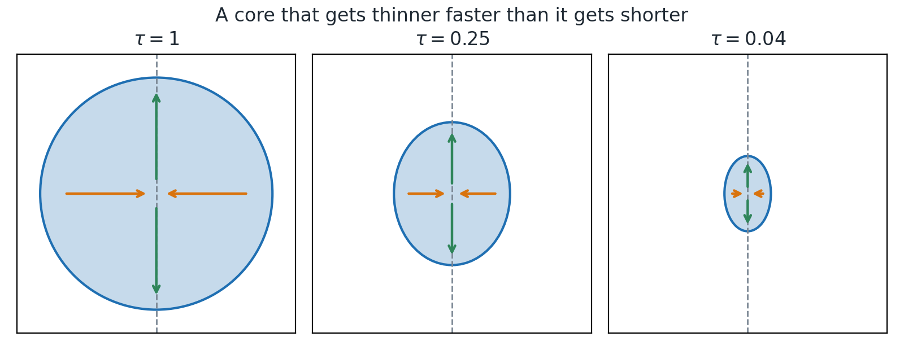
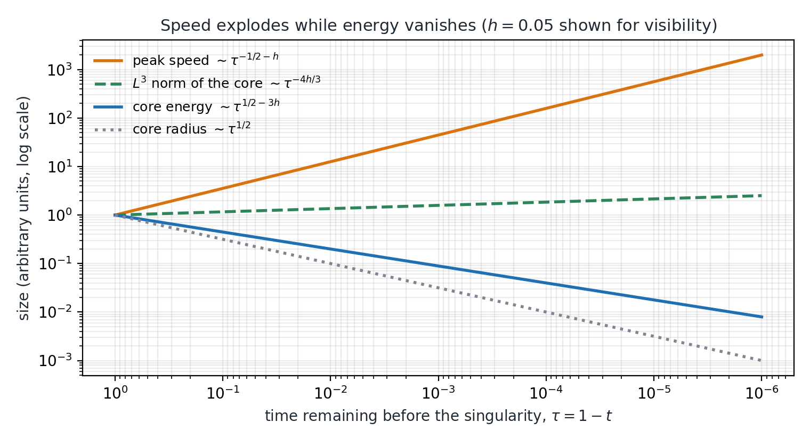
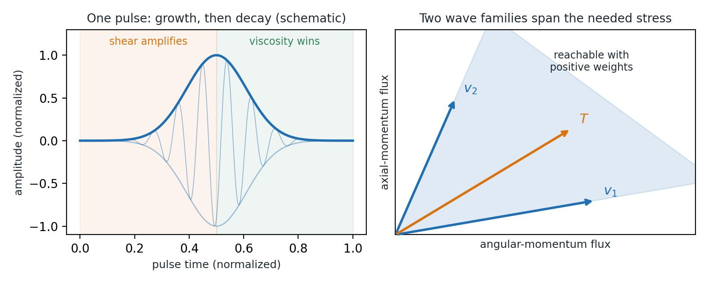
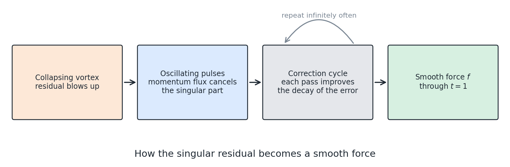

# Abstract

In September 2026 OpenAI released a 166-page paper and a Lean 4 formalization claiming that, for every positive viscosity, a smooth compactly supported force can drive the three-dimensional incompressible Navier–Stokes equations from rest to unbounded velocity at a finite time, with bounded kinetic energy. If correct, this establishes alternatives (C) and (D) of the Clay Millennium problem statement. It does not settle the unforced alternatives (A) and (B), which concern the case without an external force. This essay explains the mechanism without assuming a background in fluid mechanics beyond basic vector calculus, adds our own scale checks, reports our rerun of the formal verification, and separates four things that public discussion often merges: what the paper argues, what the Lean theorem states, what has been independently reviewed, and what remains disputed.

# How to read this essay

Every substantive claim carries a tag saying where it comes from.

| Tag | Meaning |
|:--|:----------|
| **[P]** | Stated in OpenAI's paper. We report it; we have not independently verified the full proof. |
| **[L]** | Read directly in the Lean source at commit `f9e8bc5b`. Reading is not compiling. |
| **[V]** | Output of tools we ran ourselves on that commit. Logs are kept with this essay. |
| **[C]** | Our own computation, reproducible with the script `scale_checks.py`. These are heuristic scale checks, not proofs. |
| **[R]** | Reported by a third party (cited). We have not confirmed it independently. |

All the mathematics of the construction is due to the cited authors. **We compiled the Lean project and ran the Comparator tool, but we did not verify the written proof.** Section 9 states exactly what we ran and its limits.

# 1. The question

The incompressible Navier–Stokes equations describe a viscous fluid with velocity $u(x,t)\in\mathbb{R}^3$ and pressure $p(x,t)$:

$$\partial_t u + (u\cdot\nabla)u - \nu\Delta u + \nabla p = f,\qquad \nabla\cdot u = 0,\qquad u(\cdot,0)=u_0.$$

The term $(u\cdot\nabla)u$ is nonlinear and can push energy toward ever smaller scales. The term $\nu\Delta u$, with viscosity $\nu>0$, smooths velocity differences. The central question is which effect wins in three dimensions. Leray built global weak solutions in 1934, but whether smooth data stay smooth has remained open.

Fefferman's Clay description asks for a proof of **any one** of four statements:

| | Domain | Force | Claim |
|:-|:---|:---|:------|
| (A) | $\mathbb{R}^3$ | $f\equiv 0$ | Smooth solutions with bounded energy always exist |
| (B) | $\mathbb{R}^3/\mathbb{Z}^3$ | $f\equiv 0$ | Smooth solutions always exist |
| (C) | $\mathbb{R}^3$ | allowed | Breakdown occurs for some smooth data and force |
| (D) | $\mathbb{R}^3/\mathbb{Z}^3$ | allowed | Breakdown occurs for some smooth data and force |

So (C) and (D) are officially part of the problem, yet they are not the question most people have in mind, namely whether a fluid left to itself can blow up. That question is (A) and (B), and it **remains open**.

# 2. The trick: choose the flow first

The force makes the problem look strange at first. Take any smooth incompressible velocity and any pressure, and define

$$\mathcal{R}(u,p) := \partial_t u + (u\cdot\nabla)u - \nu\Delta u + \nabla p.$$

Setting $f:=\mathcal{R}(u,p)$ makes the equation true by definition. So finding *a* solution with *some* force is trivial. **[P]**

The whole difficulty is the requirement that $f$ stay smooth, with every derivative, **through** the singular time, while $u$ blows up. Each term of $\mathcal{R}$ may diverge. Only their sum must remain bounded, and so must all its derivatives. Blowup therefore has to be produced by the fluid's own nonlinear dynamics. The paper's goal is a precise cancellation problem: build a flow whose residual is smooth even though the flow is not. **[P]**

**Theorem (paper, Thm 1.1).** For every $\nu>0$ there are a force $f\in C_c^\infty(\mathbb{R}^3\times(0,\infty);\mathbb{R}^3)$, a compact set $K$, and smooth $u,p$ on $\mathbb{R}^3\times[0,1)$ solving the equations with $u(\cdot,0)=0$, supported in $K$, such that

$$\sup_{0\le t<1}\|u(t)\|_{L^2}<\infty,\qquad \limsup_{t\uparrow 1}\|u(t)\|_{L^\infty}=\infty.$$

Consequently no smooth global solution with the same data and bounded energy exists. **[P]**

Notice how strong this is: the fluid starts **at rest** and the force is compactly supported in both space and time.

# 3. The collapsing vortex

Write $\tau=1-t$ for the time remaining before the singularity. In cylindrical coordinates $(r,\theta,z)$, the leading flow is a slender vortex centred at the origin. Fluid spirals inward toward the axis and escapes along it. Radial inflow concentrates angular momentum, which spins the core up; axial outflow removes the arriving fluid, so that incompressibility does not stop the process. **[P]**

The core's shape is self-similar with two different rates, governed by a small fixed exponent $0<h<1/100$. **[P]**

| Quantity | Scale | Meaning |
|:-----|:--|:--------|
| Radius $\ell_r$ | $\tau^{1/2}$ | thins at the viscous rate |
| Height $\ell_z$ | $\tau^{1/2-h}$ | shrinks slightly more slowly |
| Volume | $\tau^{3/2-h}$ | a thinning column |
| Swirl and axial speed | $\tau^{-1/2-h}$ | **diverges** |
| Radial speed | $O(\tau^{-1/2})$ | smaller by a factor $\tau^{h}$ |
| Kinetic energy of the core | $\tau^{1/2-3h}$ | **tends to zero** |
| Angular Reynolds number | $\tau^{-h}$ | grows without bound |
| Radial Reynolds number | $O(1)$ | viscosity keeps competing |

This table contains the first surprise: speed explodes while the energy in the explosive region vanishes. The second surprise is the role of the small number $h$, to which we return in Section 7. We recomputed every exponent above from the two lengths and speeds. **[C]**

# 4. Why the vortex alone fails

Inside the core, the profile equations are chosen to balance momentum to leading order. Far away, the flow is a purely rotating "heat exterior" that solves its equations exactly. The problem lies in the annulus that joins them: there the residual is nonzero and **unbounded as $\tau\to 0$**, so it cannot be a smooth force. **[P]**

The key observation is that this bad residual can be written as the radial divergence of a stress $T=(T_{r\theta},T_{rz})$ supported in the annulus:

$$\mathcal{R}_\theta^{(0)} = -\Big(\partial_r+\frac{2}{r}\Big)T_{r\theta},\qquad \mathcal{R}_z^{(0)} = -\Big(\partial_r+\frac{1}{r}\Big)T_{rz}.$$

So the construction needs some source of internal stress in that annulus. The natural source in a fluid is the fluid itself. **[P]**

# 5. Pulses: making the fluid supply its own force

Adding a divergence-free perturbation $w$ with pressure $\pi$ gives an exact identity:

$$\mathcal{R}(u_B+w,p_B+\pi)=\mathcal{R}(u_B,p_B)+L_{u_B}(w,\pi)+\nabla\cdot(w\otimes w).$$

The last term is decisive. A rapidly oscillating wave $w$ has zero average, but its quadratic product $w\otimes w$ does not. Outward motion carrying extra swirl and inward motion carrying a deficit transport momentum in the same direction, because reversing both signs leaves the product unchanged. This is the mechanism behind Reynolds stress. The paper arranges rings of oscillating pulses so that the averaged flux cancels the singular part of the residual. **[P]**

Scale analysis shows why this can work. The waves have amplitude $A\asymp q^{-1/2-h/2}$ and wavelength $\ell\asymp q^{1/2+h/2}$, where the concentration scale $q$ behaves like $\tau$ inside the core. Then $A^2/q^{1/2}\asymp q^{-3/2-h}$, exactly the scale of the tangential momentum terms it must cancel. Meanwhile the waves are smaller than the swirl by a factor $q^{h/2}$. They can dominate the residual without dominating the flow. **[P]**, recomputed **[C]**

Three details make this a real construction. **[P]**

1. **Direction.** A flux has a fixed sign, so waves cannot produce an arbitrary stress. Two wave families with flux directions $v_1,v_2$ are used, and $T=c_1v_1+c_2v_2$ with $c_1,c_2>0$ is required. The profiles are designed so that $T$ lies inside this "admissible stress cone".
2. **Energy.** The waves grow by extracting energy from the shear of the background. Shear also shortens their radial wavelength, so viscous damping eventually overtakes the growth. Each pulse grows, then dies.
3. **Non-interference.** Pulses that overlap in space and time are kept from interacting by a device: they are given disjoint supports in an auxiliary torus variable, evaluated along a fixed phase map.

A remarkable point: each pulse is seeded by an **exponentially small** external force, and the shear does the rest.

# 6. Infinitely many corrections

Cancellation at leading order creates new errors: interactions between waves, cutoff errors, mean-flow changes. The paper runs a correction cycle with four operations, and recomputes the whole residual after each. **[P]**

1. Solve wave-amplitude equations for the nonzero angular modes.
2. Add signed amplitude increments to correct the averaged stress.
3. Correct the angular mean with zero auxiliary average.
4. Solve five radial moment equations to keep integrals balanced.

A parameter tracks the residual's decay, and each cycle improves it by a fixed amount: $\sigma_j=\tfrac15+\tfrac{j}{10}\to\infty$. The corrections are then summed using cutoffs on shrinking neighbourhoods, in a way that keeps incompressibility exact, because cutoffs act on vector potentials before taking curls. The result is flatness: every space-time derivative of the residual is $O(q^N)$ for every $N$ as $q\downarrow 0$. **[P]**

This yields a striking conclusion that is easy to overlook. **Near the singular point, the force and all its derivatives tend to zero.** At the very place and moment of blowup, the fluid is essentially unforced at infinite order. The external force does its work earlier and elsewhere.

# 7. Our consistency checks

Claims of blowup should not contradict known theorems. As a sanity test we estimated classical critical quantities on the core, using only the leading scales. These are heuristic: they ignore the profile's details and do not prove anything. **[C]**

| Quantity | Scale on the core | Consistent with |
|:-------|:-------|:---------|
| $\sup_t\|u\|_{L^2}^2$ | $\tau^{1/2-3h}\to 0$ | Bounded energy, for $h<1/6$ |
| $\int_0^{\tau_0}\!\!\int|\partial_r u|^2\,dx\,d\tau$ | $\int\tau^{-1/2-3h}\,d\tau<\infty$ | Finite dissipation, for $h<1/6$ |
| $\|u\|_{L^3}$ | $\tau^{-4h/3}\to\infty$ | The Escauriaza–Seregin–Šverák criterion |
| $\int_0^{\tau_0}\|u\|_{L^5}^5\,d\tau$ | $\int\tau^{-1-6h}\,d\tau=\infty$ | The Ladyzhenskaya–Prodi–Serrin criterion |

The third and fourth rows are, in our view, the most instructive. The theorem of Escauriaza, Seregin and Šverák rules out singularities when the $L^3$ norm stays bounded, in the unforced setting stated by the paper. Setting $h=0$ in our estimate gives a bounded $L^3$ norm on the core, which is exactly the regime such a criterion warns against. The anisotropy $h>0$, however tiny, is what makes the critical norm grow. This is our observation, not the paper's argument. In the paper, $h$ plays other explicit roles: for instance, the ratio $\ell_r^2/\ell_z^2\asymp q^{2h}$ between axial and radial diffusion supplies the expansion parameter for the background corrections. **[P]** Our check only shows that the scales pass this basic test.

We also confirmed the viscosity rescaling $u_\nu(x,t)=\sqrt{\nu}\,u(x/\sqrt{\nu},t)$, $p_\nu=\nu\,p(x/\sqrt{\nu},t)$, $f_\nu=\sqrt{\nu}\,f(x/\sqrt{\nu},t)$ in a one-dimensional model of the identity, which is why the construction need only be carried out at $\nu=1$. **[C]**

# 8. From a local flow to the theorem

**Localization.** The vector potential, swirl and pressure are multiplied by cutoffs equal to one near the singular point. Taking the curl afterward preserves incompressibility. Near $t=1$ the residual stays controlled: flatness near the origin, and explicit heat-flow bounds away from it. **[P]**

**Extension.** All derivatives of $f$ have compatible limits as $t\uparrow 1$, so $f$ extends smoothly past $t=1$ with support in $K\times[0,2]$. **[P]**

**No competitor.** Blowup of *one* solution does not immediately rule out *another* smooth solution with the same data. The paper proves a uniqueness lemma: any smooth solution with the same force and zero data and uniformly bounded energy must agree with $u$ on every $[0,T]$, $T<1$. A global smooth solution would be bounded near $(0,1)$, contradicting the growth of $u$. This is where bounded energy enters, as in statement (C). **[P]**

**The torus.** Rescale the flow to fit inside the unit cube and sum its translates over $\mathbb{Z}^3$. The copies have disjoint supports, so products do not mix them and the periodized field solves the equation exactly. This gives (D). **[P]**

# 9. What Lean certifies, and what it does not

**What we inspected directly** at commit `f9e8bc5b38b6e212696e8a30e3e91517af887bbd`. **[L]**

- The `NavierStokes` directory has 816 tracked files and about 429,000 lines.
- A text search of those Lean files finds no `sorry`, `admit` or `native_decide`, and no `axiom` declarations. A text search is weaker than an axiom audit, though `ComparatorSolution.lean` does request `#print axioms`.
- The Comparator configuration names the two target theorems and permits only `propext`, `Quot.sound` and `Classical.choice`.
- The target statement adapts the Formal Conjectures formalization by Google DeepMind. It encodes the equation, incompressibility, initial data, $C^\infty$ regularity on $\mathbb{R}^3\times[0,\infty)$, rapid decay of data and force, and uniformly bounded energy. On reading, it matches our understanding of (C); the periodic version matches (D), including periodic pressure as in the Clay errata.

**What we ran.** All of this was done in Linux containers on the same commit, with Lean v4.34.0-rc2. **[V]**

- `lake build NavierStokes.ComparatorSolution` completed all 9,371 jobs without errors. `#print axioms` reports only `propext`, `Classical.choice` and `Quot.sound` for both target theorems.
- `leanchecker --fresh NavierStokes.ComparatorSolution` exited with code 0. It produced no other output.
- On a new volume where the solution had not been compiled, and as an unprivileged user, Comparator reported that the solution is okay. Both the Lean kernel and the independent nanoda kernel (commit `8de7e0c4`) accepted it.

We also compared the statement files. **[L]** The definitions used by the proof match the Comparator challenge file, apart from the two challenge theorems themselves. Compared with the Formal Conjectures original, the challenge file changes imports, attributes, notation and comments, and removes (A) and (B); the definitions are unchanged.

**Limits of that check.** Comparator's documentation recommends also running it under `systemd-run` with AF_UNIX sockets restricted, which was not available in our container. The kernel was WSL2 6.6 with Landlock ABI v3, and Comparator calls its sandbox with `--best-effort`. A separate write test confirmed that the sandbox blocked writing. **[V]** Mathlib came from its public binary cache. The challenge statement comes from OpenAI's repository, which is why we compared it with the original. Nothing here is an independent mathematical review, and our reading of the statement's fidelity is not an expert certification.

**The Lean-to-paper gap.** Bastounis, Circelli and Hansen report mismatches between the paper and the Lean code (arXiv:2610.08144). **[R]** As summarized in a secondary review of that work, the two main examples are:

- A derivative-loss bound stated with $m+4$ derivatives in the paper is proved with $m+5$ in Lean. We confirmed both sides: equation (8.19) of the paper has $C^{m+4}$ **[P]**, and `norm_derivativeWord_inverse_le` assumes bounds at `w.length + 5` **[L]**.
- A pressure-flux bound, equation (10.19) of the paper, is proved in Lean in a different form, using different analysis. We confirmed the Lean lemma exists and is used in the uniqueness argument **[L]**, but we did not compare the two bounds term by term.

The audit's title claim is general: a compiling formalization certifies its own top-level statement, not the accompanying prose.

**Our reading of the situation.** Three separate questions should be kept apart.

1. *Does the Lean theorem compile with only the standard axioms?* This is mechanically checkable. In our runs, it does. **[V]**
2. *Does the Lean statement say what Clay's (C) and (D) say?* This is a human judgment. Our reading says yes; expert confirmation matters more.
3. *Is the paper's written proof correct as written?* Lean does not directly answer this. An internal Lean lemma being weaker than the paper's lemma does not by itself endanger question 1, provided the chain still reaches the final statement, since Lean checks the whole chain. It does mean that Lean should not be cited as a line-by-line certificate of the paper.

If question 2 also holds, and the checking tools are sound, then (C) and (D) would be true regardless of whether every line of the prose is right. That is the sense in which this formalization matters, and also the limit of what it says.

# 10. Status, as of this version

- **Independent review.** The prize catalogue records review as pending, and MathDB's automated progress summary reports no independent expert corroboration. We know of no peer-reviewed assessment. **[R]** Our reruns in Section 9 are mechanical checks, not a review.
- **Understanding.** *Scientific American* reported in October 2026 that experts found the proof hard to read and that research groups were still working through it, some with LLM help. **[R]**
- **Method.** OpenAI reports about 10,000 agents and 88 hours of compute. *The Next Web* reports that OpenAI does not intend to claim the Millennium Prize. **[R]**
- **Credit.** Tristan Buckmaster has raised concerns regarding priority and related unpublished work with Levent Alpöge; OpenAI denies any such access. These accounts are contested and we take no position. *Scientific American* reports that experts consider the methods different from the program of Córdoba and Martínez-Zoroa. **[R]**
- **What stays open.** Alternatives (A) and (B). Nothing here shows that a fluid without external forcing can blow up.

# 11. The idea in one paragraph

Pick a flow that blows up, then ask what force would be needed. Normally that force would blow up as well, and the result would be meaningless. The construction arranges otherwise: a vortex collapses into a slender column while rings of oscillating waves, amplified by the fluid's own shear, carry momentum exactly where the vortex lacks it. An endless series of corrections removes each new error until the remaining force is perfectly smooth, and even vanishes to infinite order at the singular point. Velocity becomes infinite, energy remains finite. If the proof stands, the Clay statement's allowance of a force made this possible, and the older question of a fluid left to itself is still unanswered.

# References

1. OpenAI. *Finite time blowup for Navier–Stokes*, 2026. <https://cdn.openai.com/pdf/32d9f210-8b73-45e0-91bc-82a30aef8a9a/navier-stokes.pdf>
2. OpenAI. *NavierStokesAndEuler* (Lean 4), commit `f9e8bc5b`. <https://github.com/openai/NavierStokesAndEuler>
3. C. L. Fefferman. *Existence and smoothness of the Navier–Stokes equation*, Clay Mathematics Institute. <https://www.claymath.org/wp-content/uploads/2022/06/navierstokes.pdf>
4. A. Bastounis, F. Circelli, A. C. Hansen. *Navier-Stokes lost in translation*, arXiv:2610.08144, 2026. <https://arxiv.org/abs/2610.08144>
5. J. Leray. *Sur le mouvement d'un liquide visqueux emplissant l'espace*, Acta Math. 63 (1934), 193–248.
6. L. Caffarelli, R. Kohn, L. Nirenberg. *Partial regularity of suitable weak solutions of the Navier–Stokes equations*, CPAM 35 (1982), 771–831.
7. L. Escauriaza, G. Seregin, V. Šverák. *$L_{3,\infty}$-solutions of the Navier–Stokes equations and backward uniqueness*, Russian Math. Surveys 58 (2003), 211–250.
8. D. Córdoba, L. Martínez-Zoroa. *Blow-up for the incompressible 3D-Euler equations with uniform $C^{1,1/2-\epsilon}\cap L^2$ force*, arXiv:2309.08495.
9. *OpenAI's blockbuster Navier-Stokes proof isn't what we thought it was*, Scientific American, 13 October 2026.
10. *The mathematicians published machine-checkable proofs. OpenAI announced its result on a call with reporters*, The Next Web, 8 September 2026.
11. MathDB, problem 315852. <https://mathdb.com/p/315852/navier-stokes-existence-and-smoothness>
12. Formal Conjectures, Google DeepMind. <https://github.com/google-deepmind/formal-conjectures>
